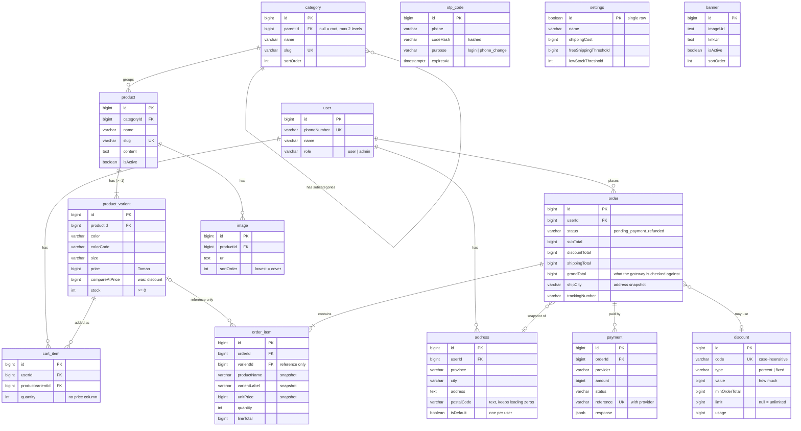

# Database Design

13 tables. Full DDL: [schema.sql](schema.sql) — a design reference, not a deployment script. Write the TypeORM entities from it, generate migrations, diff the result.

Verified: the file runs clean on PostgreSQL, and the constraints were smoke-tested (duplicate phone, second settings row, negative stock, duplicate cart line, bad enum values, duplicate payment reference — all correctly rejected).

## ERD

`settings`, `banner` and `otp_code` have no foreign keys, by design. An OTP carries no `userId` at all: it is matched to a person by `phone`, which is the login identity, and when the first code is sent there is no account yet — returning the code is what creates one.

`FK` in the diagrams above means "this column holds that table's id", not "a constraint enforces it". Seven references are real constraints; the rest are deliberately unenforced, listed under UNCONSTRAINED REFERENCES at the bottom of [schema.sql](schema.sql). The `bigint` id and money types in the diagrams are the original export — the entities use `uuid` and digits-only `varchar`.

## Four decisions that matter

**Every product has at least one variant.** Price and stock live on `product_varient`; a product with no options gets one row with `color` and `size` null. Single code path for cart, orders and stock whether or not a client sells sizes.

**Orders snapshot everything.** `order_item` copies name, label, image and price at purchase time; `order` copies the shipping address and the discount code text. So price edits can't rewrite history, and rendering an order joins nothing. Verified: deleting a product wipes its variants and images but the order item still reads back intact.

Because nothing renders from them, `order.userId`, `order.addressId`, `order.discountId`, `order_item.varientId` and `payment.orderId` carry **no foreign key at all** — they are reference only, for "buy again" and reporting. A deleted parent therefore leaves a dangling id, never a `NULL`, so anything following one must treat "not found" as a normal answer. The alternative, `SET NULL`, would mean a customer deleting an address gets to write to a financial row; nothing writes to an order except the code that owns its status.

**Money is a digits-only `varchar`, and the unit is Toman.** Never float, and never Rial — a stored `50000` means ۵۰٬۰۰۰ تومان. Zarinpal is called with `currency: 'IRT'`, hardcoded so nobody can reinterpret the stored numbers as Rial and charge a tenth of the price. (The `bigint` in the diagrams above is the original export; the entities use `varchar`.) Phone numbers and postal codes are `varchar` too, never numeric — leading zeros and `+98` are not decoration.

**Idempotency is a database constraint.** The partial unique index on `payment (provider, reference)` means a doubled gateway callback is a constraint violation you catch, not a race you hope to win. `cart_item_user_varient_unique` and `address_one_default_per_user` work the same way.

## Order creation — one transaction

1. `SELECT ... FOR UPDATE` on the variant rows — the lock that stops two customers buying the last item.
2. Re-check stock, re-price from `product_varient.price`. Never from the cart, never from the client.
3. Validate the discount code sent with the request; per-user limit = count of this user's non-cancelled orders using it.
4. Shipping from `settings` (free above `freeShippingThreshold`).
5. Insert `order` + `order_item` with the snapshot columns filled in.
6. Decrement stock, increment `discount.usage`.
7. Delete the user's `cart_item` rows.

Cancel/refund reverses step 6.

## Payment verification

Mark the order `paid` only when the gateway verifies **and** the verified amount equals `order.grandTotal` **and** the unique index accepted the reference. Never trust an amount that came back through the browser.

## Sessions

Stateless JWT in an httpOnly cookie. No token table by design — which means no force-logout and no mid-session blocking, so keep the expiry around 7 days.

## Cut deliberately

`carts` (items hang off the user), refresh tokens, discount redemptions, stock movement log, soft deletes, tax, multi-currency.

## Known naming quirks

`"user"` and `"order"` are reserved SQL words and `product_varient` is a typo of *variant* — all three work fine (TypeORM quotes identifiers), but they need quoting in every raw query and the typo will live in your entity names forever. Renaming is free right now and never again.
